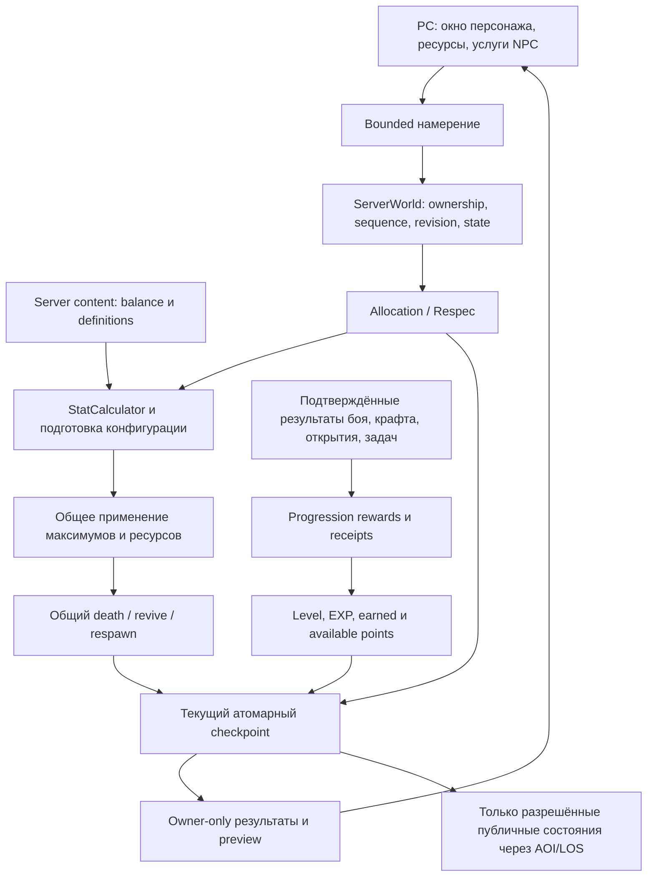
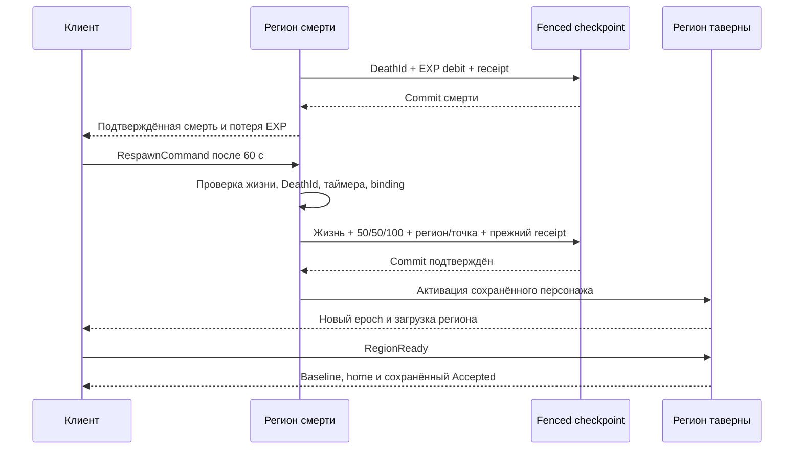

# Character & Stats — архитектура GDD 03

Дата: 2026-10-20. Статус: **направление разрешено к реализации;
C1–C4 и C5a/b реализованы и проверены; первый набор C5c реализован;
C6 с наградой очками отменён пользователем; инструменты и аудит C7 реализованы,
авторская калибровка и совместная приёмка впереди**.
Пользователь разрешил реализацию командой «го». Открытые gameplay-правила
и экспериментальные коэффициенты этим документом не утверждаются.

**Изменение 2026-10-20:** пользователь отменил награду очками характеристик за
достижения. Другая награда будет определена позднее. Предложения C6 о +1/+3
за test_boss не приняты. Новых achievement producers, SQL tables/migrations,
claims или сетевых сообщений в связи с этим этапом не вводить. Shared/world_unique
как категории не отменены. [Фиксация решения](../development/character-stats-c6-cancelled.md).
Фактические решения C1 и проверки: [отчёт](../development/character-stats-c1.md).
Ресурсы и regen C2: [реализация и проверки](../development/character-stats-c2.md).
PvE penalty и tavern respawn C3: [реализация и проверки](../development/character-stats-c3.md).
Полный сброс C4: [реализация и проверки](../development/character-stats-c4.md).
Источники и деление EXP C5a/b: [реализация и проверки](../development/character-stats-c5.md).
Мастерская/матрица/измерения C7: [результаты](../development/character-stats-c7.md).
История C7: временный STR→HP0.002 и VIT0.01 при balance20.
Последнее решение пользователя для плейтеста: +5 HP/STR и +10 HP/VIT при базе100;
общие веса0.05/0.1, balance22/schema25. Формула и серверный owner прежние,
protocol82/SQL12 сохранены. Общий калькулятор применяет веса также к NPC/Эхо.
Последующее решение пользователя: новый герой начинает с нулевыми статами,
100 HP /100 MP и20 свободными очками, +5 за уровень (165 на уровне30), balance21.
Стартовые данные и бюджет задаёт серверный content; новые ledger хранят нулевой
StartingStats. Старые ledger/вложения не переинтерпретируются; несовпадение
старого StartingStats с текущим профилем блокирует respec до явной миграции.
Смена18/+5 на20/+5 также сохраняет прежний fail-closed guard бюджета при входе:
старые Allocation ledger требуют явной миграции, рабочая БД не изменялась.
[Реализация и проверка нового старта](../development/character-stats-zero-start.md).
В частности, Int64/revision в общей схеме ниже — направление по необходимости;
C1 сохраняет нынешние int32 budgets и привязывает apply к серверному preview.

Источники: [снимок GDD 03](../design/character-stats/gdd-03.md),
[план и реестр решений](../design/character-stats/implementation-plan.md),
[gameplay contract](../design/gameplay-contract.md),
[уточнения боя D001–D129](../design/combat-system/implementation.md),
[ADR 0008](0008-character-persistence.md), [ADR 0010](0010-progression.md),
[ADR 0013](0013-local-balance-workshop.md), [combat runtime](combat-runtime.md),
[движение](movement-controls.md).

## 1. Цель и ограничения

Довести существующие характеристики, прогрессию и ресурсы до согласованной
части GDD 03. Сохранить Godot 4.7.1/.NET 10/LiteNetLib, серверный fixed tick
20 TPS, Client/Server/Shared, Development SQLite и существующий PostgreSQL
adapter. Нового процесса, микросервиса, общей библиотеки правил или DB provider
не требуется. Это развитие текущей архитектуры; документ не объявляет новый
фундаментальный ADR принятым.

Игровая поставка — PC. Godot Mobile renderer сохраняется; touch input,
Mobile HUD и мобильная сборка не входят в этот план. Численная устойчивость,
небольшие сообщения и отсутствие лишних пересчётов полезны всем платформам.

GDD 03 не разрешает менять движение, damage pipeline, стоимость Cast/Channel,
профессии, правила PvP, уровни Эхо или выдачу наград за ещё не спроектированную
торговлю. Точные блокеры перечислены в плане. Старое разрешение вайпа при
переходе боя не используется как автоматическое разрешение новой миграции.

## 2. Что переиспользуем

| Область | Фактическая основа | Разница с целевой моделью |
| --- | --- | --- |
| Первичные статы | `Content.Server/Stats/BaseStats.cs`: уже семь, WIS отдельно; player content по 10 | Нет отдельного durable разложения базы и вложений для respec |
| Производные | `StatCalculator`, `StatBalance`, `DerivedStats`, `DerivedStatModifiers`, `StatMath` | Нужны сверка формул и безопасная работа с отрицательной регенерацией; эксперимент GDD 03 не подставлять вместо согласованного боя |
| Очки/EXP | `ServerWorld.Progression`, `ProgressionBalance`, `SavedProgression`: 18/+5, cap 30, multi-level, EXP на cap обнуляется | Порог сейчас `level * ExperiencePerLevel`; нет общего учёта наград и достижений |
| Ресурсы | HP в Combatant; единственные MP/Stamina в `CombatResources`; Ability/Defense пользуются ими | Смена максимумов ограничивает текущие значения, не сохраняет процент; HP/MP regen объединён интервалом, отрицательный не исполняется |
| Жизнь | Общие CompleteDeath, DeathId, respawn/resurrection, журнал смерти | PvE EXP loss сейчас от накопленного EXP; respawn использует региональную точку, не выбранную таверну |
| Сеть/UI | Owner-only ProgressionState/StatPreview, черновик распределения, `CharacterView.tscn`, `PlayerResources.tscn` | Расширить только под новые состояния и причины отказа; не передавать формулы |
| Сохранения | CharacterState v2, SavedProgression v1, SQLite/PostgreSQL migrations до 0012, checkpoint/owner/revision fencing | Потребуются versioned allocation/respec/respawn и durable receipts; точные версии назначить при реализации |
| Баланс | `prototype.json` schema 24 / balance 19, `tools/Balance.Core`, `tools/BalanceStudio` | Подключить новую кривую и сравнения к настоящим серверным расчётам |

Это наблюдения чтения кода, не результаты нового запуска. Текущий wire — v77.
Исторические ADR с меньшими версиями не описывают текущий packet layout.

## 3. Разделение ответственности



- **Server** владеет base/derived stats, очками, EXP, условиями награды,
  ресурсами, проверками NPC/respec и жизненным циклом. `ServerWorld` координирует
  существующие подсистемы; формулы и правила вынести из его partial methods
  в небольшие чистые функции по мере изменения конкретного пути.
- **Database** хранит документы и атомарные receipts/claims, выполняет uniqueness,
  compare-and-swap и транзакции; не вычисляет условия достижения или баланс.
- **Shared** содержит стабильные numeric IDs, bounded команды, outcome и DTO.
  Не переносить StatCalculator, reward catalogs или скрытые условия в Shared.
- **Client** хранит черновик и request IDs, рисует подтверждённое состояние,
  запрашивает preview/применение. Локальная подсветка не выдаёт очки и ресурсы.
- **Tools** используют серверные каталог и калькулятор по ADR 0013; отдельного
  второго набора формул в BalanceStudio нет.

Названия новых типов ниже — рекомендуемые точки декомпозиции, не требование
создать по сервису/интерфейсу на каждую функцию.

## 4. Первичные характеристики и учёт очков

Оставить `BaseStats` каноническим числовым входом расчёта. Для игрока добавить
versioned `SavedStatAllocation`: стартовая основа семи статов, семь целочисленных
вложений, заработанные очки от создания/уровней, доступный остаток,
revision конфигурации. Это server-owned часть progression, а не клиентский DTO.
Фактические Stats в CharacterState и ledger сохраняются одним checkpoint;
при загрузке проверяется их согласованность. Нельзя хранить два независимо
редактируемых источника истины.

Инварианты для новой модели:

```text
EarnedFromLevels = 20 + 5 * (Level - 1)
EarnedTotal = EarnedFromLevels
sum(Invested[7]) + Available = EarnedTotal
PermanentStat[i] = StartingStat[i] + Invested[i]
```

Первичные постоянные значения отделены от оборудования/эффектов; снижение
характеристики дебаффом не возвращает вложенные очки. При сбросе возвращаются
все вложения; текущая стартовая база0 остаётся.
Не выводить вложения старого персонажа просто как `Stats - currentBase`: тестовые билды,
legacy и исторические награды могут не соответствовать этой формуле.

V1 storage-only `AchievementBonusPoints` сохранён для чтения исторических
документов и проверки их прежней суммы. Runtime producer для него отсутствует;
новый герой имеет 0. Это не действующий источник новых очков. Перераспределение
не удаляет уже сохранённые значения; отмена будущей выдачи не является wipe.

Стабильный существующий wire/storage порядок: **STR, AGI, VIT, INT, DEX, LUK,
WIS**. В UI допустим порядок GDD с WIS после INT через явное отображение ID.
Не переставлять индексы для совпадения с таблицей документа.

Для EXP и долговременных накопительных счётчиков предлагается `Int64` с checked
арифметикой; миграция и wire меняются согласованно. Если очки переводятся в Int64,
ограничения команд/накоплений и точное преобразование в double определяются
явно: не допускать молчаливую потерю целых за пределами представимости double.
Технические bounds защищают формат и память, не становятся тайным игровым cap.
Увеличение model bounds требует отдельной версии и проверки совместимости.

## 5. Единый расчёт и применение конфигурации

Оставить чистый `StatCalculator`; отдельная операция подготовки конфигурации
собирает permanent stats → исправное equipment → profession/passive → timed
modifiers в порядке действующего combat runtime. Не переписывать snapshot
projectiles/DoT: они сохраняют ранее принятый момент фиксации параметров.

Разделить **рассчитанный показатель** и **допустимый результат исполнения**:
сырой crit может быть отрицательным, фактическая вероятность 0…1; отрицательный
Attack не лечит; HP > 0 как максимум; MP/Stamina capacity не ниже 0. Не менять
уже принятые Accuracy, CriticalDamage, CDR и HP-cost под устаревший статус GDD 03.

Пересчёт запускают изменения вложений, equipment/прочности, профессии,
пассивки, timed effects и их окончания. Он выполняется один раз на фактическое
изменение конфигурации на соответствующей временной границе, а не один раз
за весь tick: два разных изменения внутри tick могут влиять на контакт между
ними. Preview вызывает ту же подготовку, не создавая эффектов/наград/сохранения.

`PreparedCharacterConfiguration` может содержать статы, оружие, параметры
ресурсов и revision. Сначала проверить весь результат и стоимость операции,
затем применить его целиком. Исключение не должно оставлять списанные очки
со старой экипировкой или новые статы со старым ресурсным профилем.

### Смена максимума ресурса

Предлагаемый `ResourceTransition` — одна чистая функция для HP/MP/Stamina,
которую вызывают все пути equipment/passive/effect/allocation персонажа.
Сохранение доли заполнения уже принято в §8 GDD 03; устаревший clamp в runtime
подлежит исправлению без повторного согласования этого правила:

```text
oldMax > 0: newCurrent = clamp(oldCurrent / oldMax, 0, 1) * newMax
oldMax = 0: newCurrent = 0 (ответ пользователя 2026-10-20)
dead: HP остаётся 0; изменение статов не является воскрешением
```

Значения и старые максимумы берутся из одного состояния непосредственно перед
заменой профиля. Не выполнять переход повторно на стадии Ability после Combat.
Прямое лечение/расход/respawn используют свои операции, не этот helper.
Login восстановит ресурс по последней сохранённой конфигурации; исчезновение
офлайн-эффекта/смена баланса требует явно восстановить старые максимумы из
versioned контекста, затем один раз применить переход. Не угадывать их по новым
definitions. Это входит в persistence contract и тесты reconnect.

## 6. Регенерация и хронология

Расширить существующие scheduled sets HP/MP/Defense, сохраняя единственные
балансы ресурсов. Новый общий helper интегрирует signed rate; полноценная
унификация всех runners необязательна, если повышает риск боя.

Для каждого применимого временного отрезка рассчитывается `rate * elapsed` с
сохранением дробной части. В scheduled sets должны попадать также ресурсы на
максимуме с отрицательной регенерацией. При нуле отрицательный MP/Stamina
можно усыпить до изменения условий. Не обходить всех игроков/Эхо каждый tick.

Непрерывная отрицательная HP-регенерация создаёт точную границу истощения HP
на существующем timeline, проходит общий CompleteDeath/DeathId/journal и
останавливает дальнейшие действия умершего. Нельзя объединять её раз в секунду,
позволяя мёртвому по расчёту персонажу ещё атаковать. Для MP/Stamina граница
исчерпания согласуется с платежами Channel/Block по действующему scheduler.

Нужна явная политика условий regen: in-combat, Block, action, returning NPC,
disconnect body и offline. D101 уже задаёт 100 / 15 в секунду / задержку 1 секунду;
D102 — исключение возвращающегося NPC. Дополнительные runtime-паузы не объявлять
правилами GDD без сверки. Ответ пользователя 2026-10-20: при неоднозначном
суммарном отрицательном HP regen причина смерти «Отрицательная регенерация»,
без назначения игрока-убийцы. Существующая mixed-PvP классификация риска
не меняется; kill credit последнему атакующему за такую смерть не выдаётся.

Фактическое непрерывное изменение сохраняется через существующий checkpoint
до публикации. Увеличение частоты durable writes измерить на стенде. Отложенная
запись уже показанного HP/MP нарушила бы ADR 0008; такую оптимизацию нельзя
скрытно включить ради нагрузки. Сетевое объединение допустимо после commit,
если не теряет причин/порядка событий и не меняет серверную симуляцию.

## 7. EXP и дополнительные награды

### Кривая и начисление

`ExperienceCurve` подготавливается при загрузке каталога из versioned definition:
`round(A * (L+B)^1.5)`. Проверяются конечность, положительность и представимость
порогов для поддерживаемого диапазона. Способ округления, A/B и время прокачки
требуют решения; cap не нормирует старые пороги. Можно заранее вычислить таблицу
до поддерживаемого cap, не выполнять pow по каждому reward в tick.

`ProgressionRules.Award` — чистый расчёт последовательных level-up, остатка EXP
и +5 очков за новый уровень. При cap входящий EXP не накапливается и не создаёт
запаса к будущему обновлению. Skill practice остаётся отдельной системой.

`ProgressionReward` описывает подтверждённый сервером результат с durable source
key, типом активности, версией reward config и суммой. Серверные producers:
PvE, craft completion, личное открытие, исследование, quest/event completion;
торговля/доставка подключаются после определения значимого результата.
Не создавать клиентский GrantEXP RPC, общий лимит EXP/час или подавление
валидного повторного крафта. C5 удаляет +1 за damage event: урон, эффективное
лечение и успешный контроль дают участие в общем пуле победы, а не отдельный EXP.
`Data/experience-rewards.json` v1/revision 1 содержит выбранные пользователем
временные 20 EXP, радиус 40 м, 100 новых проходимых ячеек и 5 EXP исследования.
Приложение загружает policy во все региональные worlds до загрузки героев;
в изолированных domain worlds без policy боевой EXP выключен.

### Идемпотентность и атомарность

Receipt key выводится из идентичности исходной операции, сохраняемой при retry;
новый случайный UUID на каждом повторе не предотвращает двойную награду.
Для одноразового открытия ключ содержит character + discovery ID. Для крафта
это ID завершённой операции/экземпляра, а не recipe ID: следующий честный
экземпляр снова даёт положительный EXP. Recipe reward и crafted item должны
коммититься вместе. Обычные награды могут использовать существующие durable
receipts producers; отдельный неограниченный event log каждого удара не нужен.

**Исторический проект C6 ниже снят с реализации решением 2026-10-20.**
Награда очками отменена; claims/issuance и новая persistence-модель достижений
будут пересмотрены после выбора другой награды. Следующие требования описывают
прежний проект, а не текущий план добавления таблиц:

- shared: ключ области получателя + achievement ID + согласованный occurrence;
- world_unique: уникальный ключ logical world + achievement ID + occurrence;
- receipt: persistent character UUID, reward/config version, points, source key,
  серверное время. Runtime entity ID не является получателем в БД.

Окончательный occurrence/account scope зависит от решения о повторяемости.
Секретные criteria/version definitions загружаются только сервером, не уходят
в wire и публичные тексты ошибок. Индексы uniqueness обеспечивают ровно одну
выдачу даже при двух региональных претендентах. Победитель при одновременности —
отдельное правило, uniqueness не определяет справедливый gameplay-порядок.

Расширить текущий checkpoint receipts/claims вместе с progression, inventory
и world changes; не писать в независимую БД после подтверждения игроку.
Проигравший uniqueness race не должен получить committed очки. Conflict
обрабатывается до публикации: отмена staged награды/повтор расчёта по актуальному
claim либо штатный abort checkpoint. В реализации выбрать совместимый путь
с текущим revision fencing, не превращать race в частичный commit.
Большие histories не добавлять в ограниченный 8 KiB SavedProgression JSON;
таблицы индексированы, чтение ограничено и выполняется вне gameplay hot path.

### Группа и Эхо

`ServerWorld.Experience` отделяет eligibility, равное деление и destination.
Победа получает source key NPC life UUID + death ordinal; receipt хранится на
encounter этой жизни. SavedNpcRespawn и изменения всех получателей входят в
общий checkpoint. Повторная обработка того же death ordinal не награждается;
после настоящего revive следующее поражение имеет новый death ordinal, новая
spawn life — новый UUID. Return-home сбрасывает вклад. Training targets и PvP
не создают PvE reward.

Допуск после завершения боевого frame: текущий connected/loaded живой герой,
тот же world, расстояние до места победы не больше 40 м в XYZ. Для героя
используется existing persistent root credit (в том числе вклад его спутника),
для Эхо — отдельный source конкретного экземпляра из ContributionLedger.Sources.
Эхо дополнительно должно оставаться живым активным телом того же owner в радиусе.
Смена party не переписывает вклад: party без вклада не создаёт entitlement.
Отозванное/погибшее Эхо и отсутствующий владелец не создают фантомных долей;
released projectile сохраняет исходные source/credit identities.

Пользователь выбрал отдельный EXP экземпляра Эхо и накопление дробей. Герой
получает только одну свою долю; герои на cap исключены из делителя, их дроби
не банковуются. SavedExperienceFraction v1 — точная сокращённая рациональная
дробь, numerator/denominator по 512 десятичных знаков, с fail-closed validation;
bounded JSON 8 KiB остаётся прежним. Floating point используется только для
подписи UI. Echo Experience — Int64 counter, без уровней. Capture, recall,
recovery и login сохраняют счётчик и дробь. Optional extensions совместимы
со старыми SavedProgression/SavedEchoCombat v1; SQL schema 12 не меняется.

Исследование использует durable битсет известной карты и ExperienceCells:
считаются новые проходимые ячейки из существующего reveal radius при движении.
Initial reveal и восстановление исторических landmarks не награждаются;
карты архивируются с receipt при переходе региона. Баланс rewards не мигрирует
уже выданные награды молча. Крафт/quest/discovery используют собственные ordinal,
completed-state и region/discovery bit. Нет отдельного безграничного списка hits.

Protocol v81 расширяет owner-only EchoRosterPage (ID 115, ReliableOrdered):
в конце каждой строки после Refusal добавлены Experience Int64 и доля Double
[0,1). Wire не содержит criteria или точной private дроби. Новых message IDs нет;
старый клиент отклоняется штатной проверкой версии. Обычный ProgressionState
отображает целый EXP героя; подтверждённый EXP Эхо виден в существующей подписи.

## 8. Сброс характеристик

C4 подключает полный respec через трактирщика из явно выбранного серверного списка
городских услуг; размещение стартовой таверны пока prototype до включения города
в server graph. Произвольного запроса сброса из открытого мира нет. Сервер проверяет
ownership/loaded, NPC/service, 3D range/LOS, alive, In Combat, движение/действие/обмен.
Tournament Roster Lock ещё не существует: заглушка «всегда разрешать» не добавлена,
интеграция блокировки требуется вместе с турнирной системой.

`Data/respec.json` v1: service revision, временная цена **100 монет** по ответу
пользователя 2026-10-20, TTL 15 с, stable tavern IDs. Это не финальная калибровка
на 15–30 минут заработка. Alpha использует кошелёк; альтернативный предмет не введён.

`ServerWorld.Respec` хранит owner-bound quote: nonce, server-issued operation,
цену/кошелёк/итоговый пул, текущие и будущие первичные/производные статы.
Подтверждение сравнивает TTL, NPC, ledger/историю, уровень/пул, профессию/навыки,
статы, equipment/wallet image, пересчитанный результат и service revision.
Текущий запас ресурсов не фиксируется quote: при подтверждении сохраняется его
текущая доля, регенерация продолжает работать. Stale quote не применяет изменений.

`SavedRespec` v1 — optional receipt в SavedProgression v1: Completed ordinal,
QuoteId, фактически оплаченные монеты и возвращённые очки. Первый успешный сброс
бесплатен; пустой сброс не расходует право. У персонажей с известным C1 ledger
до C4 этой услуги не было: отсутствие receipt означает отсутствие успешного сброса.
Отсутствующий/несовместимый ledger не восстанавливается по сумме статов — нужна
миграция. Будущие повреждённые receipts не подменяются новым бесплатным сбросом.

Полный сброс возвращает Invested в StatPoints, сохраняет starting stats, earned
и совместимые исторические поля V1, уровень, EXP, профессию, навыки, предметы, cooldown и ACR.
`InventorySimulation.Respec` заранее готовит equipment/resources и кошелёк;
изменения вместе с receipt и audit идут в существующий fenced atomic checkpoint.
Публикация результата — после commit. Повтор последней operation+QuoteId возвращает
AlreadyProcessed; более старая операция не повторяется. Нового reset cooldown нет.

В нынешних item/skill definitions нет требований к величине статов. Сброс не
отключает предметы/навыки и не обходит имеющиеся ограничения по оружию. При будущем
введении stat requirements нужны их обычная enforcement policy и предварительный
список несовместимостей; C4 не объявляет этот отсутствующий механизм реализованным.

Protocol v80: RespecCommand/Quote/Result 129/130/131, ReliableOrdered, quote/result
только владельцу. Рабочая `RespecView.tscn` используется и presenter, и автономным
preview. После подтверждения — переход в обычное окно распределения характеристик.
SQL schema 12 не меняется; working DB не мигрировалась.

## 9. PvE-смерть и таверна

`DeathPenaltyPolicy` подключена к текущему событию player death, включая мир без
PvP-модуля. Штраф: `min(CurrentEXP, EXPToNextLevel(Level) / 20)` с целочисленным
округлением вниз, без минимума 1 (ответ пользователя 2026-10-20). На cap: 0 без
долга, уровень и очки не уменьшаются. `SavedDeathPenalty` v1 хранит DeathId,
тип смерти и фактическую потерю; reconnect/revive не повторяют списание.
PvP policy остаётся отдельной; historical legacy death не пересчитывается задним числом.

`SavedRespawnBinding` v1 хранит stable tavern ID, placement revision, region ID
и точку проходимой поверхности; координаты задаёт серверный `TavernCatalog`.
Новому герою и legacy без binding назначается стартовая таверна Линвеля.
Услуга бесплатна у её NPC, живым персонажем вне боя; сервер проверяет ownership,
sequence/rate, состояние, 3D-дистанцию и LOS. Команда содержит только sequence и runtime NPC ID.
Удаление/перенос используемой таверны требует content migration; не переносить
персонажа молча в произвольный город.

Respawn использует существующие 60 секунд, 50% HP/MP и 100% Stamina; revive
на месте остаётся по D046, его ресурсы не заменяются respawn fractions.
Снять обычные death-removable effects, пересчитать конфигурацию, установить
respawn fractions и применить location transition одним сохраняемым результатом.
Cooldown, ACR и persist-through-death сохраняются по combat contract.
Таверна другого региона использует существующий regional transfer/fencing:
новые жизнь/ресурсы/местоположение сохраняются одним checkpoint, после commit
включается actor назначения и новый epoch. До commit нет Accepted/result/bootstrap
назначения. Ошибка staging/commit требует recovery из durable state, autosave
частично подготовленного actor запрещён. Отдельного worker/service не добавлено.
Проверены задержка commit, rollback и запрет старых epoch packets.

`Data/taverns.json` — server-only catalog; `StartingTavern.tscn` — редактируемые
NPC/Respawn markers, exporter пишет только явно заданный JSON. Пока городской
таверны нет в серверном графе, размещение временное в стартовом лагере gardens;
это не готовое здание в городской сцене. Перенос требует явной миграции binding.
Protocol v79: owner-only TavernState/Result (IDs 127/128), TavernCommand 126;
AOI QuestNpcSpawn 86 получил Height. Все эти редкие сообщения ReliableOrdered.



## 10. Сеть и интерфейс

Сохранять существующие сообщения там, где достаточно состояния. Обновление
Int64 EXP, revision, allocation/respec и binding потребует versioned wire;
новые IDs и номер назначаются после аудита текущего реестра. Старый клиент
отклоняется handshake. Commands/results/preview редкие ReliableOrdered только
владельцу; частые snapshots остаются по текущему независимому расписанию.

Revision должна меняться при любом изменении, влияющем на quote/preview;
request sequence сам по себе не защищает от смены equipment между preview и
apply. На confirm сервер заново проверяет всю операцию, формулы не читает
из клиента. Packet arrays имеют фиксированные count, числа проверяются на
диапазоны/finite до применения; MTU считать с regional envelope.

Окно персонажа: семь именованных статов, свободные очки, локальный черновик,
current/projected, отмена и применение; отдельное объяснение источников очков
без раскрытия скрытых ещё не полученных достижений. Услуга NPC показывает
цену, предупреждения, подтверждение и исход ошибки. HUD сохраняет целочисленное
отображение, точные серверные значения не округлять для боевых расчётов.

Использовать существующие редактируемые `.tscn`: CharacterView, PlayerResources,
DeathView и компоненты; новые постоянные окна также сцены. Одна рабочая сцена
для игры и автономного preview. В C# только данные/действия, подписки и cleanup.

## 11. Сохранения и rollout

Версии content schema, balance, SQL schema, CharacterState/SavedProgression
и protocol независимы. Не назначать сейчас «следующий» номер: другие работы
могут занять его до реализации. SQL для SQLite и PostgreSQL добавляется парой;
адаптеры проверяются отдельно.

Рекомендуем additive модели/таблицы и явный offline converter для старых
документов. До записи converter выдаёт dry-run: counts, старые/новые пороги,
совместимость каждого allocation, баланс очков, binding и причины отказа.
Не восстанавливать историю бесплатного respec или выдач по догадке. Изменение
EXP curve требует решения: сохранить абсолютный EXP внутри уровня либо
процент прогресса; несовместимые записи не исправлять молча.

Первый прогон — чистая тестовая БД, затем отдельная копия после разрешения
её использования; реальная `.data` не открывается планированием. Перед рабочим
cutover: остановка записи, backup, утверждённый converter, проверка инвариантов,
обновление клиента/сервера вместе. Старый binary после записи новой модели
может не читать её: rollback через backup и совместимый комплект binary/content,
а не обещание автоматического downgrade. Мировые claims и чужой прогресс
не удаляются вместе с персонажем без отдельного решения.

## 12. Альтернативы и последствия

| Вариант | Сложность / ops | Задержка / масштабирование | Проверка / миграция / отказ | PC / Mobile |
| --- | --- | --- | --- | --- |
| Расширить текущие Server модули, checkpoint и tools — рекомендуется | Умеренные патчи, прежний запуск | Нет нового сетевого перехода; dirty sets и локальные таблицы; нагрузка commit требует измерения | Чистые functions + реальные storage/UDP tests; явные model migrations; конфликт откатывает целую операцию | Небольшие owner-only DTO и общий renderer |
| Выделить независимый progression service и отдельное хранение сейчас | Новые deployment, auth и distributed ownership | Дополнительный RPC; приходится согласовывать бой, предметы и rewards | Distributed transaction/outbox, retries и новый failure mode; миграция заметно дороже | Выигрыша для клиента нет |
| Переписать все stats/resources как универсальный event-sourced framework | Большой refactor и инструменты history | Больше событий/памяти; выгода не измерена | Хороший replay ценой миграции и риска регрессий combat timeline | Дополнительная сложность не решает текущий UX |

Рекомендация сохраняет accepted foundation и минимальный vertical slice.
Труднообратимые части — новая интерпретация старого EXP/очков, списание платы
и мировая уникальная награда. Они требуют явного rollout и долговременного
receipt. Только добавление интерфейса или enum не доказывает готовность
GDD 03: нужны полные producer → transaction → owner UI сценарии.

Порядок реализации, блокеры и проверки: [план GDD 03](../design/character-stats/implementation-plan.md).

## 13. C5c — существующие authoritative activity producers

Принятые временные NPC-продажа, повторяемая поставка и «Дозор лагеря» входят
в прежний fixed-tick мир и общий durability barrier. Нового процесса, транспорта
или базы нет. Продажа использует существующий economy operation receipt;
последний номер/статус поставки хранится в optional `SavedDeliveryOrder` героя,
номер/active/reward revision/pool запуска — в optional `SavedCampWatch` региона.
Cargo, EXP, receipt и аудит фиксируются вместе; публикация только после commit.
Запущенный «Дозор» сохраняет величину бонуса при смене конфигурации и restart.
Delivery revision при несовместимом сохранении требует явной миграции.

Protocol v82: bounded owner-only ActivityCommand/State/Result (132–134),
ReliableOrdered; публичные высоты resource/station и EXP в economy quote
расширяют существующие DTO. Частота snapshots не меняется. SQL schema 12
сохраняется: используются строго проверяемые optional versioned JSON components.
Старый бинарник не читает новые поля — откат требует сохранённой совместимой
копии базы. Рабочая БД в этом срезе не мигрировалась и не открывалась.

Редактируемая сцена сервисов экспортирует только placement в server-only
`camp-services.json`, сохраняя ручные reward/text настройки. Definitions
валидируются по ссылкам и поверхности до запуска UDP. Правила и критерии
награды не переносятся в Shared. [Результат C5c](../development/character-stats-c5c.md).
