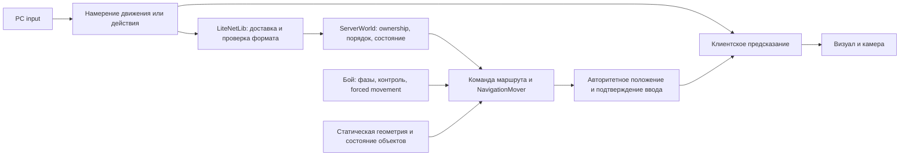

# Movement & Controls — архитектура по GDD 02

Дата: 2026-10-17. Направление реализации одобрено пользователем; работа начата.
Фактическое состояние срезов и проверки — в [плане](../design/movement-controls/implementation-plan.md).

Уточнение пользователя: **текущая реализация только для PC**. Touch input,
виртуальный joystick, Mobile HUD и Mobile Aim Assist полностью исключены из
этой задачи. Раздел Mobile исходного GDD сохранён как источник будущих требований.

Источники поведения: [GDD 02](../design/movement-controls/gdd-02.md),
[GDD 01](../design/combat-system/gdd-01.md) и его
[прямые уточнения пользователя](../design/combat-system/implementation.md).
[План и оценка](../design/movement-controls/implementation-plan.md).

## 1. Задача и границы

Привести существующие движение, ввод и камеру к GDD 02, сохранив серверную
авторитетность и рабочий бой GDD 01. Развивать текущий модульный сервер в одном
процессе. Godot, .NET, LiteNetLib, базу данных и Client/Server/Shared не заменять.

Принятые правила ГД являются требованиями. Предложения ГД, алгоритмы ниже и
названия новых классов — варианты реализации. Открытые gameplay-вопросы не
закрываются выбором удобного алгоритма. Межпроцессный handoff, виды транспорта
и их сроки не становятся обязательной частью первой PC-поставки.

Нужно синхронизировать локальные источники перед реализацией: старые формулировки
`AGENTS.md` и `gameplay-contract.md` про автоатаку/автоподход расходятся с GDD 01.
Старый контракт также не закрепляет принятые в GDD 02 падения и параметры камеры.
Этот документ фиксирует расхождения, но сам не изменяет приоритет источников и
не объявляет новые решения принятыми пользователем.

## 2. Что уже есть

| Участок | Переиспользовать |
| --- | --- |
| Клиент | `PlayerController`, выбор физической поверхности, история ввода, prediction/reconciliation и remote interpolation |
| Навигация | `NavigationMover`, `SurfaceMover`, `SurfaceNavigation`, экспорт Godot → публичные данные → независимые .NET queries |
| Сервер | `ServerWorld`, `ServerPlayer`, fixed tick, spatial/AOI, общий timeline движения и боевых контактов |
| Бой | `ActionInstance`, фазовые разрешения движения/поворота, defense, control и forced movement |
| Сеть | Versioned bounded packets, region epoch, `MoveCommand`, `EntitySnapshot`, обработка устаревших sequence |
| Жизненный цикл | Текущие checkpoint, reconnect, сохранение координат/направления и смена региона |
| Обзор | `ForestOcclusion` и `CanopyReadability` как частные адаптеры будущей общей политики перекрытий |

Наблюдаемое исходное состояние: симуляция 20 TPS, обновление цели удерживаемой
ПКМ через 100 мс, жёсткая визуальная коррекция при ошибке свыше 3 м, камера 45°.
Скорость обычного перемещения сейчас 3,5 м/с; GDD 02 оставляет числовую скорость
открытой. До отдельного решения сохранять текущее значение как параметр прототипа.
Follow, общий rebinding и полный Mobile input в изученном runtime не обнаружены.

## 3. Разделение ответственности

### Content.Client

- Один небольшой `GameplayInput` переводит Godot actions в
  намерения. Он маршрутизирует ввод; cooldown, damage и допустимость пути
  по-прежнему определяет сервер. Не переносить сюда всю combat presentation.
- `PlayerController` остаётся владельцем локального prediction и применения
  snapshots; выбор поверхности сохраняется. Извлекать его prediction в отдельный
  класс только при реальном затруднении тестирования, а не ради структуры папок.
- `CameraController` отвечает за фиксированную камеру и zoom;
  `OcclusionPresentation` — за видимость визуальных перекрытий.
- UI настраивает bindings и Follow через редактируемые `.tscn`.
  Новые постоянные окна не строятся одноразовым C#-генератором.

### Content.Server

- `ServerWorld` принимает намерения и связывает навигацию с боем и lifecycle.
  Transport не выполняет gameplay-переходы при получении пакета.
- Небольшой `PlayerNavigationState` у `ServerPlayer` хранит актуальную команду,
  её порядок и состояние Follow. Вычисление пути остаётся в `NavigationMover`.
- `FollowSystem` появляется вместе с Follow: хранит только активные связи и
  обращается к существующим игрокам, AOI и pathfinder.
- Динамические опоры и падения добавляются отдельными небольшими модулями по
  мере реализации; не превращают транспорт или `ServerWorld` в физический движок.

### Content.Shared / Content.Database

- Shared: компактные публичные DTO/enums, проверки формата, общая математика
  движения и геометрические queries. Не server policy Follow, NPC secrets или AI.
- Database: существующее durable положение. Маршруты, удержание кнопок, Follow
  и очереди ввода — runtime-состояние сессии, не сохраняемые задания.
- Bindings и zoom — локальные пользовательские настройки клиента.

Интерфейс на каждый класс, новая ECS, message bus и новый DI-контейнер не нужны.

## 4. Модель движения и связь с боем

### 4.1. Команда и фактическое движение — разные состояния

Для первой поставки достаточно `NavigationMode = Idle / Destination /
FollowCursor / FollowActor`. Хранить текущую точку либо ID цели, sequence/order,
результат последней обработки и данные восстановления Follow.

`Arrived`, `Cancelled`, `Unreachable` — результаты команды с причиной, а не
отдельные долгоживущие объекты. `Restricted` и `ForcedMovement` определяются
состоянием боя; не дублировать их во второй управляющей боем state machine.
Mounted/Passenger добавляются при появлении соответствующей механики.

Каждый слой имеет единственного владельца: input intent → проверенный маршрут →
авторитетный transform → отображаемый transform. Направление боевого действия
живёт в существующем combat state и не перезаписывается поворотом модели.

### 4.2. Обычный бег

- Без режимов walk/sprint и без разгона/инерции. Настройки скорости меняют
  постоянную скорость движения, а не кривую ускорения.
- Вне боевого ограничения серверное направление сразу следует фактическому
  движению. Модель должна выполнять требование мгновенного поворота; плавное
  смешивание поз не задерживает направление, положение или достижение точки.
- Скорость и запреты берутся из существующих combat modifiers. Root, Slow,
  Block и разрешения конкретной фазы не рассчитываются повторно в новом модуле.
- Любое принятие точки проверяет поверхность, версию геометрии, границы и путь.
  Игроки не становятся препятствиями; hurtbox не используется для movement blocking.

Уточнение пользователя 2026-10-17 заменяет path-following для удерживаемой ПКМ:
FollowCursor — прямое направление, без A* обхода. Shared solver ограничивает
физический шаг первым препятствием; при упоре сохраняет намерение бега,
но фактическая velocity для combat равна нулю. Отпускание удержания сразу
останавливает движение (надёжный Stop), не превращает его в Destination.
Короткий клик по земле остаётся Destination с поиском пути. Порог отличия
короткого клика — редактируемая клиентская настройка прототипа (0,18 с),
не фундаментальное gameplay-число. Само движение начинается сразу по нажатию.

### 4.3. Отмена маршрута

Общее правило GDD 02: собственное активное действие отменяет предшествующую
обычную команду; окончание действия её не возобновляет. Это не запрещает новое
движение, если само действие разрешает его по GDD 01.

Подключить одну явную точку `CancelNavigation` к событию фактического начала
разрешённого действия на существующем combat timeline. Она очищает команду и
Follow, но не отзывает серверный Dash, Knockback/Pull или движение опоры.
Во время подготовки, active/recovery дальше действуют уже существующие
фазовые разрешения. Не переносить движение за пределы общего timeline: иначе
контакт и положение начнут относиться к разным моментам fixed tick.

Уточнено пользователем 2026-10-17: preview, отклонённый ввод и ещё ожидающая
команда боевого буфера маршрут не отменяют. Фактическое начало разрешённого
действия отменяет текущий маршрут; окончание ожидания не сохраняет маршрут,
введённый во время буфера. Удерживаемая ПКМ после отмены ждёт отпускания и
нового нажатия. Новая ПКМ во время запрещающей движение фазы отклоняется,
не запоминается для выполнения после фазы.

Не увеличивать боевой буфер: максимум одна ожидающая команда по GDD 01.
Follow не является боевым auto-walk; атака не запускает Follow или автоподход.

### 4.4. Порядок команд при разных каналах доставки

Sequence отдельной атаки не задаёт порядок относительно sequence движения.
Нужен один session-scoped `InputOrder` для навигационных намерений и контекста
действия, которое отменяет маршрут. Это компактный номер порядка, а не новый
event log. Существующие combat sequence/execution IDs сохраняют свои обязанности.

Сервер хранит watermark применённого/отменённого навигационного ввода. Старый
пакет движения не может восстановить маршрут после начавшегося действия.
При фактическом старте отмена охватывает текущий маршрут, даже если действие
ждало в буфере. Новая команда, принятая уже после старта и разрешённая фазой,
может начать движение. Клиент удаляет отменённые команды из replay.
Stop и Follow подключают тот же порядок на своих этапах.

Поля, порядок и wrap-around покрыть тестами до wire-изменения. Всё это остаётся
в текущем региональном envelope с проверкой ownership и region epoch.

## 5. Fixed tick, сеть и prediction

С учётом более позднего решения D129 базовые частоты: **20 TPS** симуляция, **20 Hz** snapshots удалённых
персонажей, **20 Hz** обновление направления удерживаемой ПКМ. Локальный выбор
курсора/preview работает независимо от сетевой частоты.

- TPS задаётся конфигурацией (базово 20 по D129); handshake сообщает действительную частоту.
  Клиент предсказывает с тем же fixed delta. Ни один таймер боя не должен
  незаметно остаться рассчитанным на 20 тиков в секунду.
- Отправку snapshots отделить от очистки результатов боя/жизненного цикла.
  Сейчас они связаны внутри `BroadcastSnapshot`; простое пропускание каждого
  N-го вызова задержит либо потеряет результаты других подсистем.
- Использовать небольшой accumulator/deadline scheduler для 20 Hz. Деление
  через `tick % N` не даёт 20 Hz при 30 TPS. Без интерполяции серверных состояний
  допустима дискретизация отправки по соседним simulation ticks: 33/67 мс,
  в среднем 20 Hz. Проверять jitter и не объявлять ровные интервалы по одному среднему.
- Owner acknowledgement включается в те же ограниченные movement snapshots;
  отдельный высокочастотный поток подтверждений пока не нужен.
- События spawn/despawn, смена региона и ответы критичных команд идут своим
  надёжным путём, независимо от расписания частых snapshots.

Предлагаемая доставка:

| Намерение / данные | Доставка и проверка |
| --- | --- |
| Разовый Destination, Stop, StartFollow, CancelFollow | ReliableOrdered; sequence/order, ограничение частоты, owner и epoch |
| Обновления удерживаемой ПКМ; позже joystick | Sequenced, актуальное намерение повторяется с 20 Hz; старый order отбрасывается независимо от канала |
| Movement snapshots | Unreliable, проверка server tick, ack и geometry revision |
| Результат навигационной команды / причина Follow stop | ReliableOrdered владельцу, bounded reason enum |
| Боевые команды | Существующий GDD 01 delivery, добавляется только необходимый контекст порядка |

Разовый клик не должен теряться из-за того, что следующий snapshot не пришёл;
частые обновления не должны накапливать надёжную очередь. Первая точка задаёт
маршрут для короткого клика. По уточнению M004 удержание управляет направлением
напрямую, отпускание отправляет надёжный Stop. Само отсутствие отдельных
cursor-пакетов не означает отпускание; disconnect обрабатывается отдельно.

Каждое намерение несёт возрастающий sequence/order и клиентскую метку времени,
не авторитетное положение. ClientTick не использовать как часы при смене TPS.
Сервер оценивает метку относительно сессии, проверяет допустимый диапазон и
частоту; клиент не выбирает server time или rewind. Лимиты — настройки,
проверяемые тестами и профилированием, не новые gameplay-числа.

Расширять текущие `MoveCommand` и `EntitySnapshot` минимально: состояние команды,
ack и причина отмены нужны первыми. Velocity вычисляется из simulation segment;
отдельно передавать её только если она нужна интерполяции/движущимся опорам.
Не добавлять все предложенные поля ГД автоматически. Изменение layout требует
новой protocol version, пересборки обеих сторон и точного packet budget ≤1200
байт с region envelope. Номера сообщений выбираются по фактической версии при реализации.

### Коррекция и отключение

Серверная истина применяется сразу, а мягкость относится к визуальному
отображению. Ошибка обычного перемещения до 0,5 м включительно сглаживается;
свыше 0,5 м либо недопустимый сегмент — немедленная жёсткая коррекция.
Повторять только неподтверждённые и не отменённые команды с актуальными
геометрией и фазовыми ограничениями. Не прокладывать визуальное сглаживание
через стены или на другой этаж. Длительность сглаживания остаётся настройкой
до проверки; особые движения требуют отдельных правил ГД.

Disconnect прекращает обычный маршрут и Follow на сервере. В бою тело остаётся
на 60 секунд по GDD 01, эффекты/принудительные движения продолжаются. Reconnect
восстанавливает серверное состояние, очищает старую историю input и не
возобновляет маршрут. Потерянные отдельные пакеты не трактуются как disconnect.

## 6. Камера, перекрытия и ввод

### Камера

Один дочерний rig игрока, наклон 55° относительно горизонта, без свободного
вращения и позиционного сглаживания. Фокус жёстко следует корню персонажа,
включая высоту, падение и движение опоры; анимационный наклон капсулы фокус
не двигает. Не добавлять look-ahead и SpringArm, который смещает центр кадра.

Zoom меняет дистанцию в пределах 70–130% исходной, шаг — ровно 5 процентных
пунктов за деление колеса. 100% — явно настраиваемая стандартная дистанция
сцены; числовое значение и touch-жест не закреплены ГД. Projection остаётся
текущей, если изменение не требуется отдельным решением.

### Перекрытия

Помеченные меши крон/крыш/стен имеют редактируемые роли видимости. По локальному
spatial query проверяются только объекты между камерой и своим персонажем;
для них применяется до 20% opacity, затем исходное состояние восстанавливается.
Материал/прозрачность экземпляра не должны менять все здания с общим ресурсом.
Физические коллайдеры сохраняются. Предпочитать переиспользование текущего
индекса крон, а не полный scan сцены в `_Process`.

Видимость своего персонажа и раскрытие других игроков — разные правила.
Скрытая крыша не раскрывает чужую модель без прямой видимости от персонажа.
Использовать публичную серверную геометрию/состояние дверей для LOS;
AOI ограничивает кандидатов, а не доказывает видимость. Проверять также
отправляемые данные: локальное скрытие mesh не защищает от раскрытия секретов.
Точный критерий LOS и частота пересчёта — открытая реализация, измеряемая на
реальной карте; отдельную всевидящую камеру серверу не моделировать.

Реализация статического M3: `OcclusionPresentation` в `PlayerAvatar/Occlusion`
индексирует меши региона один раз, обновляет ближайшие клетки каждые 0,05 с
и подменяет только материалы затронутых экземпляров. В Mobile renderer
`GeometryInstance3D.Transparency` не поддерживается: используются кэшированные
копии Standard/ORM и fade-варианты известных painted shaders. Авторские ресурсы,
коллайдеры и source hash региона не меняются. Группы `camera_fade`, `camera_roof`
и существующие forest/collision пометки задают редактируемые роли.

Серверный технический критерий M3 — существующий body-to-body ray на высоте
1 м от стоп через `SurfaceVisibility` (на flat-прототипе — консервативная grid
проверка). Это точка настройки реализации, а не правило нового игрового зрения.
Проверка выполняется для AOI-кандидатов на server tick; свой игрок исключён
из отсечения. Потеря LOS использует существующий despawn, возврат — свежий
spawn/state; wire layout не меняется. Echo проходят тот же LOS, NPC сохраняют
прежний AOI. Выпущенный снаряд имеет собственный LOS и не раскрывает исходную
точку скрытого кастера. Партийный приватный presence сохраняет контракт ADR 0011.
Движущиеся occluders/двери и обновление индекса входят в M8. Проверки и настройки:
[отчёт M3](../development/movement-controls-m3.md).

### Ввод и переназначение

Названные Godot actions и один router вместо дальнейшего размножения проверок
`PhysicalKeycode` по presentation-классам. Все игровые действия, включая
движение/атаки/защиту/Stop/Follow/окна/zoom, получают явные bindings и локальное
сохранение. UI navigation не обязана повторять игровые bindings.

Общие проверки router: UI focus, modal, chat, alive, активный регион,
потеря фокуса и симметричный release/cancel. Не привязывать серверное поведение
к названию кнопки или FPS. Точная раскладка ЛКМ/Ctrl+ЛКМ и Stop открыта в GDD 02:
до решения сохранять текущую как прототип; отсутствие auto-approach обязательно.

### Граница платформы

В этой задаче реализуется только PC input. Мобильные адаптеры, joystick,
редактор Mobile HUD, assist и проверки на телефоне не создаются. На PC
Aim Assist отсутствует по ГД. Общий протокол и серверная математика остаются
независимыми от кнопок, но дополнительные интерфейсы ради будущего Mobile не нужны.
Название Godot Mobile renderer не означает мобильную платформу: текущий renderer
сохраняется и проверяется на PC.

## 7. Follow

Серверная команда с runtime ID видимого игрока; без согласия цели и без проверки
членства в группе. При старте проверяются ownership, alive, регион, видимость
и расстояние ≤40 м. Следующий персонаж обычным бегом держит 3 м.

Хранить активные пары follower→target и индекс target→followers для отмены по
смерти/выходу/смене региона. Не обходить всех игроков ради поиска последователей.
Pathfinder переиспользуется; частота и допуск перепланирования — ограниченные
технические настройки. Таймер восстановления — 5 секунд, не перезапускаемый
каждым повторным неудачным поиском. После неудачи — owner-only причина остановки.

Ручное движение/своё действие отменяют Follow; получение урона и PvP сами по себе
его не отменяют. Особые действия цели не копируются, между регионами Follow
не переносится. Переход цели в другой физический server при той же игровой зоне
требует отдельного уточнения с handoff. Видимость, метрика дистанции и поведение
на узком уступе/другом этаже уточняются до реализации, не выводятся из X/Z по умолчанию.

## 8. Рельеф, падение и динамические объекты

Статический polygon mesh и его revision остаются основой. Обычный прыжок,
лазание и плавание не добавляются. Глубокая вода помечается непроходимой
геометрией; граница мелководья и способ транспорта требуют данных/решения.

### Падение

После решения правил схода с уступа добавить серверное состояние опоры и
вертикальную скорость. Потеря разрешённой опоры запускает падение; пересечение
геометрии и приземление определяет сервер. Позиция по высоте не берётся из
заявления клиента. При приземлении рассчитанный урон проходит через действующие
damage/death/persistence-пути, а не прямо меняет HP из navigation-кода.

Формула/пороги урона, допустимые уступы, защитные состояния и связь с боевым
Airborne открыты. Не включать «временную» смертность падений или запекать
весь край карты как постоянное разрешение прыгнуть вниз. Нужны отдельные
тесты падения и боевого forced movement; общая высота не делает их одной механикой.

### Двери, мосты, лифты, платформы

Серверные определения объектов и простое runtime-состояние: transform,
доступность прохода, connection endpoints. В сцене — placement и публичный
preview; экспорт server-side не зависит от Godot. Не перестраивать весь navmesh
каждый tick. Начать с blocker/link для двери/моста, затем добавить движущуюся опору.

Для пассажира хранить runtime support ID и local offset, рассчитывая world
transform от серверной опоры. Само движение опоры проверяется вместе с
коллизиями; закрытие двери не проталкивает персонажа сквозь стену. Snapshot
опоры и привязанного персонажа должны относиться к совместимому времени.
Связь опоры, ревизии и пассажира нужна только при реализации этого этапа.

Правила входа/схода, блокировки дверей телом, потери опоры и восстановления
при reconnect открыты. Они задают acceptance, а не выбираются молча в solver.
Live-DM-деформация мира не добавляется этим направлением.

## 9. Маунты, транспорт, карты и handoff

Маунт использует профиль конкретного типа и существующие queries движения;
универсальная скорость/инерция не устанавливаются. Посадка, спешивание,
урон и сохранение владения требуют отдельного gameplay-контракта. Passenger
физического транспорта может переиспользовать движущуюся опору, но расписание,
билеты и обязательность общественного транспорта пока не утверждены.

Физический путь занимает игровое время. Fast travel, gameplay layers и
телепортация при отставании Follow не появляются. Корабли и воздушные поездки
остаются поздними возможностями. Система торговли картами не выводится из
навигации автоматически: ГД подтверждает ценность карт, но прежний план
явно откладывал их обмен. Требуется отдельное согласование объёма.

Маршрут не раскрывает скрытые проходы, счётчики или всю неизвестную геометрию.
Для карты игрок получает только разрешённые знания; сервер может проверить
проходимость без передачи клиенту найденных секретов. Не отправлять скрытый
полный путь под видом косметической линии.

В текущем процессе переиспользовать имеющийся atomic region travel. Реальный
межсерверный handoff — отдельный предложенный ADR, когда выбран следующий
deployment-этап: один владелец персонажа, durable transfer fence, ack уже
обработанного ввода, recovery при недоступном назначении. Не создавать сейчас
gateway, кластерный координатор или второй zone server ради будущей готовности.
Существующие gateway/zone намерения ГД не означают, что seamless handoff уже выполнен.

## 10. Проверка и последствия

- **Protocol:** новые поля/команды ограничены, version bump, malformed/replay/
  packet budget, перестановки между ReliableOrdered и Sequenced, reconnect/epoch.
- **Persistence:** первая PC-поставка без новых таблиц; session intent не durable.
  Падения, опоры и маунты отдельно проверяют versioned сохранение, без вайпа.
- **Performance:** active sets, AOI, ограниченный pathfinding/LOS, без global
  scan на каждый ввод. При выбранных 20 TPS (D129) измерить CPU/tick и трафик на той же карте.
- **Платформа:** PC; существующий Godot Mobile renderer сохраняется. Мобильные
  сборки, устройства и UX не входят в реализацию или приёмку этой задачи.
- **Verification:** build, targeted domain/protocol/UDP tests, Godot stand и
  реальная игровая карта. Старый stale export сначала воспроизвести отдельно;
  нельзя записать его в результаты новой movement-проверки как успешный.

## 11. Рассмотренные варианты

| Вариант | Оценка |
| --- | --- |
| Расширять текущие модули, добавить явную команду маршрута и отдельные scheduler/input/camera | **Рекомендуется.** Сохраняет бой, навигацию, БД и deployment; небольшие проверяемые изменения. Риски — старые implicit cancellations и таймеры, их закрывают целевые тесты |
| Полностью переписать locomotion/бой в универсальную FSM/ECS и ввести распределённый movement service | Выше стоимость миграции, отладка порядка и дополнительная эксплуатация; нет измеренной необходимости для текущей альфы. Не даёт гарантированного преимущества задержки или Mobile |

Рекомендация не меняет accepted foundation. Труднообратимые изменения изолированы:
wire требует совместного обновления клиента/сервера; новые сохранения вводятся
только versioned; реальное межпроцессное владение требует отдельного ADR.
